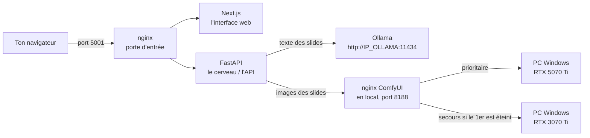

# Installer Presenton sur un homelab, sans Docker

Un tutoriel pas à pas pour installer [Presenton](https://github.com/presenton/presenton), un générateur de présentations par IA (open-source, dans l’esprit de Gamma, Canva ou Beautiful.ai). Ici, on l’installe **directement** sur un serveur **Debian 13**, sans Docker.

Tu n’as pas besoin d’être expert. Chaque idée un peu technique est expliquée la première fois qu’elle apparaît. En revanche, ce n’est pas un jouet : tu vas vraiment installer un service sur une machine, éditer des fichiers de configuration, et (si tu veux des images générées) brancher d’autres PC du réseau.

> **Presenton est un projet tiers.** Le logiciel lui-même vit ici : [github.com/presenton/presenton](https://github.com/presenton/presenton), sous licence [Apache 2.0](https://github.com/presenton/presenton/blob/main/LICENSE). Ce dépôt contient uniquement le tutoriel et les scripts d’installation native, sous licence [MIT](LICENSE).

Si tu veux le détail complet (versions, commandes manuelles, options avancées), va voir le [guide technique](docs/INSTALL-TECHNIQUE.md).

---

## Sommaire

1. [Ce que tu vas construire](#1-ce-que-tu-vas-construire)
2. [Les mots à connaître](#2-les-mots-à-connaître)
3. [Ce dont tu as besoin](#3-ce-dont-tu-as-besoin)
4. [Avant de commencer](#4-avant-de-commencer)
5. [Étape 1 — Récupérer ce dépôt](#étape-1--récupérer-ce-dépôt)
6. [Étape 2 — Lancer le script d’installation](#étape-2--lancer-le-script-dinstallation)
7. [Étape 3 — Régler la configuration](#étape-3--régler-la-configuration)
8. [Étape 4 — Brancher ComfyUI pour les images (optionnel)](#étape-4--brancher-comfyui-pour-les-images-optionnel)
9. [Étape 5 — Démarrer Presenton](#étape-5--démarrer-presenton)
10. [Étape 6 — Créer ta première présentation](#étape-6--créer-ta-première-présentation)
11. [Commandes utiles au quotidien](#11-commandes-utiles-au-quotidien)
12. [Dépannage](#12-dépannage)
13. [Pour aller plus loin](#13-pour-aller-plus-loin)

---

## 1. Ce que tu vas construire

Presenton n’est pas un seul programme. Plusieurs petits services travaillent ensemble, derrière une porte d’entrée unique.



En résumé :

- **Presenton** tourne sur un serveur Debian 13. Tu l’ouvres dans le navigateur, en général à l’adresse `http://IP_PRESENTON:5001`.
- **Ollama** écrit le texte des diapositives. Il peut être sur la même machine ou sur une autre, sur le réseau local.
- **ComfyUI** (optionnel) dessine les images, de préférence sur un PC Windows avec une carte graphique NVIDIA. S’il y en a deux, le premier (ici une RTX 5070 Ti) est utilisé en priorité ; le second (une RTX 3070 Ti) prend le relais seulement si le premier est éteint.

Tu n’es pas obligé d’avoir les deux PC Windows pour commencer. Tu peux d’abord faire tourner l’interface et le texte, puis ajouter les images plus tard.

---

## 2. Les mots à connaître

| Mot | Ce que ça veut dire |
| --- | --- |
| **Terminal** | Une fenêtre où tu tapes des **commandes** (des phrases que l’ordinateur exécute), au lieu de cliquer. Sur Debian, tu peux l’ouvrir depuis le menu, ou te connecter à distance avec SSH. |
| **Commande** | Une instruction écrite, par exemple `ls` pour lister des fichiers. Tu la valides avec Entrée. |
| **sudo** | « Fais cette commande avec les droits administrateur. » Le système te demandera souvent **ton** mot de passe (celui du compte Linux), pas un mot de passe Presenton. Les caractères ne s’affichent pas quand tu le tapes : c’est normal. |
| **Adresse IP** | Le « numéro de rue » d’un ordinateur sur le réseau, par exemple `192.168.1.10`. Dans ce tutoriel, on utilise des **placeholders** (des mots à remplacer) : `IP_PRESENTON`, `IP_OLLAMA`, `IP_5070TI`, `IP_3070TI`. |
| **Port** | Comme le numéro d’appartement à cette adresse. Presenton écoute par défaut sur le port **5001**. Ollama, par défaut, écoute sur **11434**. ComfyUI écoute sur **8188**. |
| **URL** | L’adresse complète que tu tapes dans le navigateur, par exemple `http://192.168.1.10:5001`. `http` est le protocole, ensuite l’IP (ou un nom), puis le port après `:`. |
| **Service** | Un programme que Linux peut démarrer tout seul au boot, et relancer s’il plante. Ici, on utilise **systemd** (le chef d’orchestre des services sur Debian). Les trois services Presenton sont groupés sous `presenton.target`. |
| **Fichier `.env`** | Un fichier de réglages, une variable par ligne (`NOM=valeur`). Le nôtre est `/etc/presenton/presenton.env`. Il peut contenir un mot de passe : on ne le publie jamais sur Internet. |
| **Réseau local (LAN)** | Les machines de chez toi (ou de ton labo), généralement en `192.168.x.x`. Elles se parlent entre elles, sans passer par Internet. |
| **IP fixe / réservation DHCP** | Une adresse qui ne change pas à chaque redémarrage. Tu la règles soit sur le PC, soit dans la box / le routeur (« réserver cette IP pour cette machine »). C’est important, sinon Presenton cherchera tes GPU à la mauvaise adresse. |
| **GPU** | La carte graphique. Elle est beaucoup plus rapide qu’un processeur pour générer des images. |
| **Placeholder** | Un texte temporaire à remplacer, comme `IP_OLLAMA`. Tant qu’il est encore écrit tel quel, ça ne marchera pas. |

> **Astuce :** `127.0.0.1` (aussi appelé *localhost*) veut dire « cette machine-ci ». Presenton parle à ses propres services en `127.0.0.1`. Pour Ollama ou ComfyUI qui tournent **sur un autre PC**, il faut leur vraie adresse sur le réseau, pas `127.0.0.1`.

---

## 3. Ce dont tu as besoin

- Un serveur ou un PC sous **Debian 13** (Trixie), architecture amd64, avec un compte qui a le droit d’utiliser `sudo`.
- Une connexion Internet **pendant** l’installation (téléchargement du code, des paquets, de Node, de Python, etc.).
- Environ **4 Go de RAM** pour Presenton tout seul, **8 Go ou plus** si Ollama tourne sur la même machine.
- Un peu de temps : le script peut prendre **20 à 40 minutes**, surtout à cause de la compilation du frontend.

Optionnel, mais recommandé :

- Un serveur **Ollama** déjà installé, avec le modèle `qwen3.5:9b` (bon compromis qualité / vitesse). Si Ollama est sur la même machine que Presenton, l’URL sera `http://127.0.0.1:11434`. S’il est sur une autre machine, ce sera `http://IP_OLLAMA:11434` — remplace `IP_OLLAMA` par l’adresse de cette machine. Le port **11434** est le port par défaut d’Ollama.
- Pour les images : un ou deux PC sous **Windows 11 Pro**, avec une carte NVIDIA (par exemple une RTX 5070 Ti en principal et une RTX 3070 Ti en secours). Il leur faut un pilote NVIDIA récent (série 580 ou plus pour une 5070 Ti).

> **Attention :** n’expose pas Presenton, Ollama ou ComfyUI directement sur Internet sans réfléchir (pare-feu, HTTPS, mot de passe). Ce guide est pensé pour un **réseau local**.

---

## 4. Avant de commencer

- Si le serveur n’est pas le tien, demande à la personne qui le gère **avant** d’installer quoi que ce soit.
- Note quelque part, sur papier ou dans un fichier local :
  - l’IP de la machine Presenton → `IP_PRESENTON`
  - l’IP de la machine Ollama → `IP_OLLAMA` (ou `127.0.0.1` s’il est sur le même hôte)
  - éventuellement les IP des deux PC GPU → `IP_5070TI` et `IP_3070TI`
- Idéalement, réserve une IP fixe à chaque machine dans ta box.
- Vérifie que le port **5001** est libre sur le serveur Presenton.

Tu es prêt ? On y va, une étape à la fois.

---

## Étape 1 — Récupérer ce dépôt

Sur la machine Debian 13, ouvre un terminal et tape :

```bash
sudo apt-get update
sudo apt-get install -y git
cd /root
sudo git clone https://github.com/fredcolinlux/presenton-homelab-sans-docker.git
cd presenton-homelab-sans-docker
ls
```

**Tu dois voir :** des fichiers et dossiers comme `install.sh`, `presenton.env.example`, `nginx`, `systemd`, `scripts`, `comfyui`, `docs`, `README.md` et `LICENSE`.

> **Astuce :** tu peux cloner ailleurs qu’dans `/root`, par exemple dans ton dossier personnel. L’important est de lancer `install.sh` depuis le dossier du dépôt.

---

## Étape 2 — Lancer le script d’installation

Le fichier `install.sh` fait le gros du travail : paquets Debian, Node 22, Python 3.11, copie du code Presenton, construction de l’interface, nginx, services systemd. Il **n’allume pas** encore les services : tu pourras relire la config avant.

```bash
sudo ./install.sh
```

Laisse-le aller jusqu’au bout. S’il s’arrête avec une erreur, copie le message et va à la [section Dépannage](#12-dépannage).

**Tu dois voir**, à la fin, un texte du genre « Installation terminée » et une liste de prochaines étapes.

Le script installe notamment :

- **Python 3.11** avec `uv`, parce que Debian 13 fournit Python 3.13, alors que Presenton exige 3.11 ;
- **Node 22** (via NodeSource), parce que le Node de Debian est trop ancien ;
- Chromium et ImageMagick, pour exporter en PDF / PowerPoint ;
- nginx, qui servira l’interface sur le port 5001.

> **Attention :** le script a besoin d’Internet et de droits administrateur. Ne l’interromps pas au milieu d’un téléchargement si tu peux l’éviter.

---

## Étape 3 — Régler la configuration

Ouvre le fichier de réglages :

```bash
sudo nano /etc/presenton/presenton.env
```

`nano` est un éditeur dans le terminal. Tu te déplaces avec les flèches, tu modifies le texte, puis tu quittes avec `Ctrl+O` (enregistrer), Entrée, puis `Ctrl+X` (fermer). Si tu préfères `vim` ou un autre éditeur, utilise-le.

### L’URL que tu ouvriras dans le navigateur

Remplace la valeur par l’adresse **réelle** que tu taperas :

```bash
PRESENTON_PUBLIC_URL=http://IP_PRESENTON:5001
```

Exemple : si le serveur a l’adresse `192.168.1.10`, tu écris `http://192.168.1.10:5001`. Si tu testes uniquement sur la machine elle-même, `http://127.0.0.1:5001` suffit.

### Ollama (le texte des slides)

Les lignes importantes ressemblent à ceci :

```bash
LLM=ollama
OLLAMA_URL=http://IP_OLLAMA:11434
OLLAMA_MODEL=qwen3.5:9b
START_OLLAMA=false
MEM0_LLM_BASE_URL=http://IP_OLLAMA:11434
MEM0_LLM_MODEL=qwen3.5:9b
```

Remplace **`IP_OLLAMA`** aux deux endroits (`OLLAMA_URL` et `MEM0_LLM_BASE_URL`).

Règles simples pour cette URL :

- **Sans slash `/` à la fin.** Écris `http://IP_OLLAMA:11434`, pas `http://IP_OLLAMA:11434/`.
- **Sans** `/api` à la fin : Presenton l’ajoute tout seul.
- Si Ollama tourne sur la machine Presenton : `http://127.0.0.1:11434`.
- Le port par défaut est **11434**. Ne mets un autre port que si tu as vraiment changé celui d’Ollama.

Laisse `START_OLLAMA=false` : on ne demande pas à Presenton d’installer Ollama, il existe déjà ailleurs (ou tu l’as installé toi-même).

### Compte administrateur (optionnel)

Tu peux créer le compte plus tard dans le navigateur, ou le préparer maintenant :

```bash
AUTH_USERNAME=admin
AUTH_PASSWORD=choisis-un-mot-de-passe-solide
```

Le nom doit faire au moins 3 caractères, le mot de passe au moins 8. Choisis un vrai mot de passe, et ne le commite nulle part.

### Vérifier qu’Ollama répond

Toujours **depuis la machine Presenton** :

```bash
curl -sS -m 10 http://IP_OLLAMA:11434/api/tags
```

N’oublie pas de remplacer `IP_OLLAMA`.

**Tu dois voir :** un texte JSON qui commence par `{"models":[` et liste tes modèles. Si `qwen3.5:9b` n’y est pas, installe-le sur la machine Ollama avec :

```bash
ollama pull qwen3.5:9b
```

> **Astuce :** `qwen3.5:9b` est un bon choix (présent dans le catalogue testé par Presenton, assez costaud sans être énorme). Si ta machine est juste en mémoire, `llama3.2:3b` est plus léger. Si tu as de la marge, `qwen3:14b` ou `gpt-oss:20b` sont plus lents, souvent un peu meilleurs.

Enregistre le fichier, puis passe à l’étape suivante. Si tu n’as pas encore de GPU pour les images, tu pourras déjà démarrer (étape 5) et revenir à l’étape 4 plus tard. Dans ce cas, tu peux aussi mettre `DISABLE_IMAGE_GENERATION=true` dans le `.env` en attendant.

---

## Étape 4 — Brancher ComfyUI pour les images (optionnel)

Presenton ne sait pas demander des images directement à Ollama de façon fiable (cette fonctionnalité d’Ollama est expérimentale, et souvent absente). La solution prévue ici, c’est **ComfyUI**, un programme qui génère des images, de préférence sur un GPU NVIDIA.

L’idée : les deux PC Windows font tourner ComfyUI sur le port 8188. Sur le serveur Presenton, nginx écoute en local sur `127.0.0.1:8188` et envoie le travail vers la 5070 Ti en priorité, ou vers la 3070 Ti si la première ne répond pas. On ne « répartit » pas les images entre les deux cartes : Presenton doit récupérer chaque image sur **la même** machine qui l’a produite.

Le modèle utilisé des deux côtés est **SDXL Turbo** : il est rapide, et il tient dans les 8 Go de VRAM d’une 3070 Ti.

### Sur chaque PC Windows 11

1. Installe un **pilote NVIDIA récent**. Pour une RTX 5070 Ti, il faut typiquement un pilote de la série **580** ou plus récent.
2. Télécharge le **portable NVIDIA** depuis les [releases ComfyUI](https://github.com/comfyanonymous/ComfyUI/releases) (fichier du style `ComfyUI_windows_portable_nvidia…`). Extraie-le, par exemple dans `C:\AI\ComfyUI_windows_portable`.
3. Télécharge le fichier `sd_xl_turbo_1.0_fp16.safetensors` depuis [stabilityai/sdxl-turbo](https://huggingface.co/stabilityai/sdxl-turbo/blob/main/sd_xl_turbo_1.0_fp16.safetensors) et place-le dans `ComfyUI\models\checkpoints\` **sur les deux PC**. Le nom du fichier doit être exactement celui-là.
4. Depuis ce dépôt, copie à la **racine** du portable (à côté de `python_embeded` et de `run_nvidia_gpu.bat`) :
   - `comfyui/run-comfyui-lan.bat`
   - `comfyui/run-comfyui-lan-debug.bat`
   - `comfyui/install-firewall-lan.ps1`
   - `comfyui/install-autostart-task.ps1`
5. Double-clique sur `run-comfyui-lan-debug.bat`.

   **Tu dois voir :** ComfyUI qui démarre, et l’interface qui répond sur `http://127.0.0.1:8188` dans le navigateur **de ce PC**. Fais un essai de génération avec SDXL Turbo, surtout sur la 3070 Ti, pour vérifier que la mémoire vidéo suffit.
6. Ouvre **PowerShell en administrateur** (clic droit sur le menu Démarrer → « Terminal administrateur » ou « Windows PowerShell (admin) ») et, depuis le dossier du portable :

```powershell
powershell -ExecutionPolicy Bypass -File .\install-firewall-lan.ps1
```

   Par défaut, le script autorise le port 8188 seulement depuis `192.168.1.0/24` (un exemple courant de réseau local). Si tes machines sont sur une autre plage, adapte :

```powershell
powershell -ExecutionPolicy Bypass -File .\install-firewall-lan.ps1 -RemoteAddress "192.168.1.0/24"
```

   **Tu dois voir :** un message confirmant que la règle de pare-feu est installée.

7. Pour lancer ComfyUI automatiquement au démarrage de Windows :

```powershell
powershell -ExecutionPolicy Bypass -File .\install-autostart-task.ps1
Start-ScheduledTask -TaskName "ComfyUI Presenton"
```

8. Donne à chaque PC une **IP fixe** (ou une réservation DHCP dans la box) et note `IP_5070TI` et `IP_3070TI`.

> **Attention :** le script de lancement ouvre ComfyUI sur toutes les interfaces (`--listen 0.0.0.0`) pour que le serveur Presenton puisse l’atteindre. N’ouvre **pas** le port 8188 sur Internet. Le pare-feu doit le limiter à ton réseau local.

### Sur le serveur Presenton

Édite le fichier nginx du proxy (le script d’install l’a déjà copié, mais pas activé, tant que les IP sont des placeholders) :

```bash
sudo nano /etc/nginx/sites-available/comfyui-presenton
```

Remplace `IP_5070TI` et `IP_3070TI` par les adresses réelles, puis :

```bash
sudo ln -sfn /etc/nginx/sites-available/comfyui-presenton /etc/nginx/sites-enabled/comfyui-presenton
sudo nginx -t && sudo systemctl reload nginx
```

**Tu dois voir :** `nginx: the configuration file /etc/nginx/nginx.conf syntax is ok` et `test is successful`.

Dans `/etc/presenton/presenton.env`, ces lignes doivent déjà être présentes :

```bash
IMAGE_PROVIDER=comfyui
COMFYUI_URL=http://127.0.0.1:8188
ENABLE_PARALLEL_IMAGE_GENERATION=false
```

Laisse `COMFYUI_URL` sur `http://127.0.0.1:8188` : Presenton parle au proxy local, pas directement aux PC Windows.

Test depuis le serveur Presenton (en mettant tes vraies IP) :

```bash
curl -sS -m 5 http://IP_5070TI:8188/system_stats
curl -sS -m 5 http://IP_3070TI:8188/system_stats
curl -sS -m 5 http://127.0.0.1:8188/system_stats
```

**Tu dois voir :** du JSON avec des infos sur le système / le GPU, pas une erreur de connexion. Le troisième test passe par nginx : s’il répond alors que la 5070 Ti est éteinte, c’est que le secours (3070 Ti) a pris le relais (parfois après une quinzaine de secondes).

Un script tout-en-un existe aussi :

```bash
IP_5070TI=192.168.1.10 IP_3070TI=192.168.1.11 \
  sudo -u presenton ./comfyui/test-comfyui-from-presenton.sh
```

(Remplace les exemples `192.168.1.10` et `192.168.1.11` par tes adresses.)

Le détail des choix techniques (pourquoi pas de répartition de charge, format du workflow, etc.) est dans le [guide technique, section 10](docs/INSTALL-TECHNIQUE.md).

---

## Étape 5 — Démarrer Presenton

```bash
sudo systemctl enable --now presenton.target
sudo systemctl reload nginx
sudo systemctl status presenton-fastapi presenton-nextjs presenton-mcp nginx
```

`enable --now` veut dire : « démarre maintenant, et relance aussi après un redémarrage de la machine ».

**Tu dois voir :** `active (running)` pour les services, en vert si ton terminal affiche les couleurs. Si l’un est `failed` ou `inactive`, va au dépannage et regarde les journaux :

```bash
sudo journalctl -u presenton-fastapi -u presenton-nextjs -u presenton-mcp -e
```

Depuis la machine elle-même, tu peux aussi tester :

```bash
curl -sS -o /dev/null -w "%{http_code}\n" http://127.0.0.1:5001/
```

**Tu dois voir :** `200` (la page répond).

Ouvre ensuite, depuis un navigateur sur le réseau local :

```text
http://IP_PRESENTON:5001
```

**Tu dois voir :** l’interface Presenton, ou l’écran de création du compte admin si tu ne l’as pas défini dans le `.env`.

---

## Étape 6 — Créer ta première présentation

1. Crée le compte administrateur si ce n’est pas déjà fait (nom ≥ 3 caractères, mot de passe ≥ 8).
2. Va dans les **Paramètres** et vérifie que le fournisseur de texte est bien **Ollama**, avec le modèle `qwen3.5:9b` (ou celui que tu as choisi), et que le fournisseur d’images est **ComfyUI** si tu as fait l’étape 4.
3. Lance une génération courte, par exemple 4 ou 5 diapositives sur un sujet que tu connais.
4. Si tout va bien, essaie un export **PPTX** ou **PDF**.

La première génération peut être un peu lente (chargement du modèle Ollama, éventuellement de ComfyUI). Les suivantes sont en général plus rapides.

> **Astuce :** l’API documentée est aussi visible sur `http://IP_PRESENTON:5001/docs` une fois que tu es connecté.

---

## 11. Commandes utiles au quotidien

```bash
# État des services
sudo systemctl status presenton.target presenton-fastapi presenton-nextjs presenton-mcp nginx

# Suivre les logs en direct (Ctrl+C pour quitter)
sudo journalctl -u presenton-fastapi -u presenton-nextjs -u presenton-mcp -f

# Redémarrer uniquement le backend (utile après un changement du .env ou du workflow)
sudo systemctl restart presenton-fastapi

# Tout redémarrer
sudo systemctl restart presenton.target
sudo systemctl reload nginx

# Arrêter Presenton
sudo systemctl stop presenton.target
```

Après une modification de `/etc/presenton/presenton.env`, redémarre au moins `presenton-fastapi` (et souvent tout `presenton.target`) pour que les nouvelles valeurs soient lues.

---

## 12. Dépannage

| Tu vois… | Quoi vérifier |
| --- | --- |
| `Permission denied` ou le script refuse de démarrer | Lance-le avec `sudo`, depuis le dossier du dépôt : `sudo ./install.sh`. |
| `requires-python >=3.11,<3.12` | Debian 13 a Python 3.13. Il faut Python 3.11 via `uv` (le script s’en charge). Ne force pas le `python3` du système. |
| Erreur pendant le build de l’interface (Next.js, `sharp`, lockfile) | Il faut **Node 22** et **npm 11.16.0**, pas le Node 20 de Debian. Relance le script, ou vois le [guide technique](docs/INSTALL-TECHNIQUE.md). |
| `nginx -t` échoue / port déjà utilisé | Un autre site écoute peut-être déjà sur 5001. Change le `listen` dans `/etc/nginx/sites-available/presenton`, ou désactive le site en conflit. |
| Les services sont `failed` | `sudo journalctl -u presenton-fastapi -u presenton-nextjs -u presenton-mcp -e` : lis les dernières lignes, souvent un oubli dans le `.env` ou un fichier manquant. |
| La page ne s’affiche pas depuis un autre PC | Vérifie `PRESENTON_PUBLIC_URL`, le pare-feu de Debian (`sudo ss -lptn \| grep 5001` : nginx doit écouter sur `0.0.0.0:5001` ou `*:5001`), et que tu utilises bien le port 5001. |
| `curl` vers Ollama ne répond pas / expire | Mauvaise IP, Ollama éteint, mauvais port, ou un pare-feu entre les deux machines. Teste d’abord `curl http://IP_OLLAMA:11434/api/tags` depuis Presenton. Vérifie aussi l’absence de slash final dans `OLLAMA_URL`. |
| Presenton démarre mais le texte échoue | Le modèle n’est pas tiré (`ollama pull qwen3.5:9b`), ou `OLLAMA_URL` est encore le placeholder `IP_OLLAMA`. |
| Images en échec / timeout ComfyUI | ComfyUI n’écoute pas sur le réseau (`--listen 0.0.0.0`), le pare-feu Windows bloque le port 8188, l’IP a changé, ou le checkpoint `sd_xl_turbo_1.0_fp16.safetensors` n’est pas au bon endroit. Teste `curl http://IP_5070TI:8188/system_stats`. |
| Le proxy local (`127.0.0.1:8188`) échoue, mais le PC GPU répond en direct | Le site nginx `comfyui-presenton` n’est pas activé, ou les placeholders `IP_5070TI` / `IP_3070TI` n’ont pas été remplacés. `sudo nginx -t` puis `sudo systemctl reload nginx`. |
| Export PDF / PPTX qui plante | Paquets `chromium` et polices installés ? `PUPPETEER_EXECUTABLE_PATH=/usr/bin/chromium` dans le `.env` ? Assez de RAM ? |
| `/app_data/...` en 401 | Tu n’es pas connecté (cookie de session). C’est normal si tu n’es pas loggé. |
| Mot de passe oublié | Tu peux utiliser `RESET_AUTH=true` **ponctuellement** dans le `.env` puis redémarrer le backend (voir le guide technique). Remets-le à `false` ensuite. |

---

## 13. Pour aller plus loin

- Le [guide technique](docs/INSTALL-TECHNIQUE.md) reprend la même installation en détail : paquets, Python, Node, nginx, systemd, mises à jour, et tout le chapitre ComfyUI.
- Les fichiers utiles de ce dépôt :
  - `install.sh` — installation en root
  - `presenton.env.example` — modèle de configuration (à copier vers `/etc/presenton/presenton.env`)
  - `nginx/` — site Presenton sur le port 5001
  - `systemd/` — services `presenton-fastapi`, `presenton-mcp`, `presenton-nextjs`, et `presenton.target`
  - `scripts/` — lancement FastAPI (charge le workflow ComfyUI) et assemblage du frontend
  - `comfyui/` — workflow SDXL Turbo, scripts Windows, proxy nginx actif/passif
- Mise à jour de Presenton : voir la [section 14 du guide technique](docs/INSTALL-TECHNIQUE.md). Fais une copie de `/var/lib/presenton/app_data` avant (surtout `fastapi.db` et `userConfig.json`).

---

## Licences et origine

- **Presenton** : projet tiers, [github.com/presenton/presenton](https://github.com/presenton/presenton), licence [Apache 2.0](https://github.com/presenton/presenton/blob/main/LICENSE).
- **Ce dépôt** (tutoriel, scripts d’installation, fichiers systemd, nginx et ComfyUI) : licence [MIT](LICENSE).
- ComfyUI, Ollama, SDXL Turbo et les autres outils cités restent la propriété de leurs auteurs, chacun avec sa propre licence.

Bonne install, et bonnes présentations.
